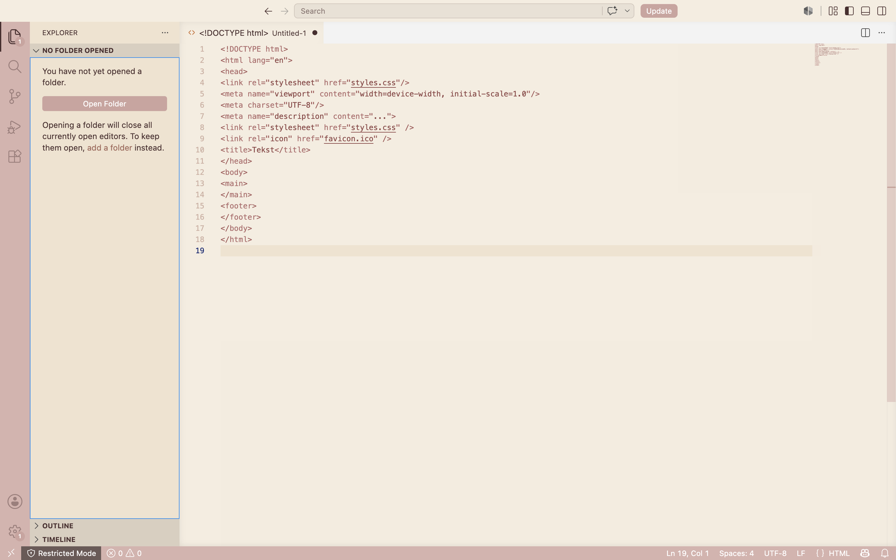
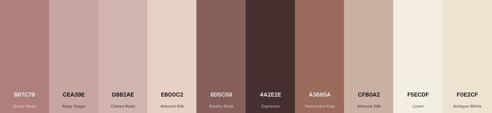

# Dusty Rose Light

A calm, feminine light theme for new developers.  
Inspired by soft rose tones, minimalist UI, and a gentle coding experience.

## ✨ Features
- Light, soothing color palette
- Optimized for readability and focus
- Perfect for beginners, designers, and creative coders

## 🌸 Preview

## 🎨 Color Palette

## Installation
Search for "Dusty Rose Light" in the Extensions Marketplace or install from VSIX.

---
Check out my Dusty Rose Dark too!
Designed by [Fineline Studio](https://www.finelinestudio.nl/portfolio/dusty-rose), a graphic design studio in Zeeland, the Netherlands.  
© 2025 by [Fineline Studio](https://www.finelinestudio.nl)
